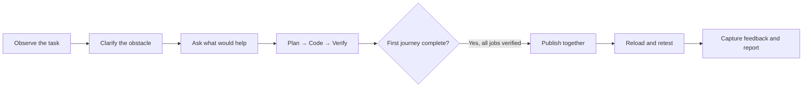

<div align="center">

# Loop

### See the friction. Change the site. Test it again.

**Live website research with a face-to-face AI interviewer and a coding agent.**

[Try the demo](https://35-226-89-51.sslip.io/) · [Architecture](docs/ARCHITECTURE.md) · [Run locally](docs/SETUP.md) · [Demo walkthrough](docs/DEMO.md)

[](https://github.com/PrakharGoel7/loop/actions/workflows/checks.yml)


</div>


## The idea

User testing often ends with a list of things to fix. Loop brings the next step into the same conversation: **observe a problem, ask the person what would help, build a small change, and let them try it.**

A Tavus interviewer, Mira, talks to the participant while they use a website. Screen perception and instrumented website events provide context for questions. Once the participant confirms an obstacle and suggests a remedy, a background coding agent implements a targeted UI change. After the first journey and verification finish, the same person tries the revision and gives feedback.

Loop is a prototype for dynamic website testing. **The included clothing store is the demonstration environment**, not a restriction on the product idea. Supporting another website currently requires adapting its instrumentation and editable source scope; this is not an arbitrary-URL testing service.

## What it does

| Capability | In the demo |
| --- | --- |
| Face-to-face interviewing | Tavus CVI provides the video conversation, voice, and turn taking. |
| Questions grounded in behavior | Raven observes the shared screen and camera; website events add precise navigation, selection, and checkout signals. Cues prompt clarification, not a diagnosis of emotion. |
| Store access in the conversation | Magic Canvas presents the website link. |
| Native knowledge retrieval | Tavus retrieves a ranked concern from an attached CSV of **synthetic past-user research**. |
| Real code changes | A planner scopes the suggestion; a coding worker edits an isolated copy of the store. No prepared patch is used in the active flow. |
| Verified publication | Up to two changes run sequentially. Publication requires every accepted change to verify and the first journey to finish. |
| Immediate retesting | Mira asks for feedback on each published change, then wraps up. |
| Evidence you can review | Two report sections: friction cards with clip, quote, fix, and revised quote; then the event timeline. |

## The loop



The interview continues while work runs. After checkout, Mira asks about the overall experience, then a knowledge-base concern, and follows up while needed. The reload invitation waits for the required debrief and the current answer to finish. Publishing the revision and inviting the participant to retry are separate decisions.

## Explore the implementation

| Start here | What to look for |
| --- | --- |
| [Architecture](docs/ARCHITECTURE.md) | System diagram, event flow, worker queue, and publication boundary. |
| [Interviewer prompt](server/interviewer-prompt.ts) | Question style, evidence gathering, acknowledgements, and retest rules. |
| [Tavus integration](server/tavus.ts) | PAL setup, perception, tools, Magic Canvas, and native knowledge documents. |
| [Worker orchestration](server/repair.ts) | Planning, bounded edits, verification, cancellation, and restoration. |
| [Report assembly](server/report-summary.ts) | Linking observed issues to actual quotes and revisions. |
| [Testing and evaluation](docs/TESTING.md) | Automated checks, real-worker evals, and what they do not prove. |

## Try it

**Hosted:** [Open Loop](https://35-226-89-51.sslip.io/). No invite code is required. Use a desktop browser, allow camera and microphone access, and share the store tab or window when asked. The public demo supports **one active study at a time**. Checkout is simulated; no real payment is needed.

**Local:** Node.js 22.12+, pnpm 10, Git, an authenticated Codex CLI, and a Tavus API key are required for the full experience. FFmpeg prepares friction clips.

```bash
git clone https://github.com/PrakharGoel7/loop.git
cd loop
pnpm install --frozen-lockfile
cp .env.example .env
# Set LOOP_CODEX_BIN to your Codex executable in .env.
pnpm dev:all
```

Open `http://127.0.0.1:5173` and configure Tavus. The example environment disables native knowledge retrieval for the first local run, because Tavus needs a publicly reachable document URL. [Setup instructions](docs/SETUP.md) explain how to enable it.

## Scope and tradeoffs

- **A working prototype, not a production research platform.** It has a two-change budget, one active study, and a narrow store-code edit boundary.
- **Verification is not proof of usefulness.** Source checks, TypeScript, and a production build gate publication. Optional browser regression checks add coverage; the participant's retry evaluates the experience.
- **Interview timing is probabilistic.** Backend code enforces queue and publication rules; Tavus objectives and prompts guide the spoken conversation.
- **Research examples are synthetic.** The knowledge CSV is demo data, not findings collected from actual participants.
- **Study media is private.** Clips, transcripts, credentials, and execution logs are excluded from this repository. Hosted visitors can access their own studies; configuration is managed on the server.
- **Leaving ends the study.** Navigating away or closing the interview tab sends an end request. A roughly two-minute heartbeat timeout covers lost connections. Switching to the store tab does not end the call.

The repository retains clearly labeled [legacy prepared-patch experiments](prepared-repairs/README.md). They are outside the current repair path.

## Built with

React · TypeScript · Vite · Express · Tavus CVI · Daily · Codex CLI · FFmpeg · Google Cloud Storage

The hosted app and warm coding worker run separately on Google Compute Engine. GitHub hosts the source and automated checks; it does not run the interview backend or deploy changes automatically.
