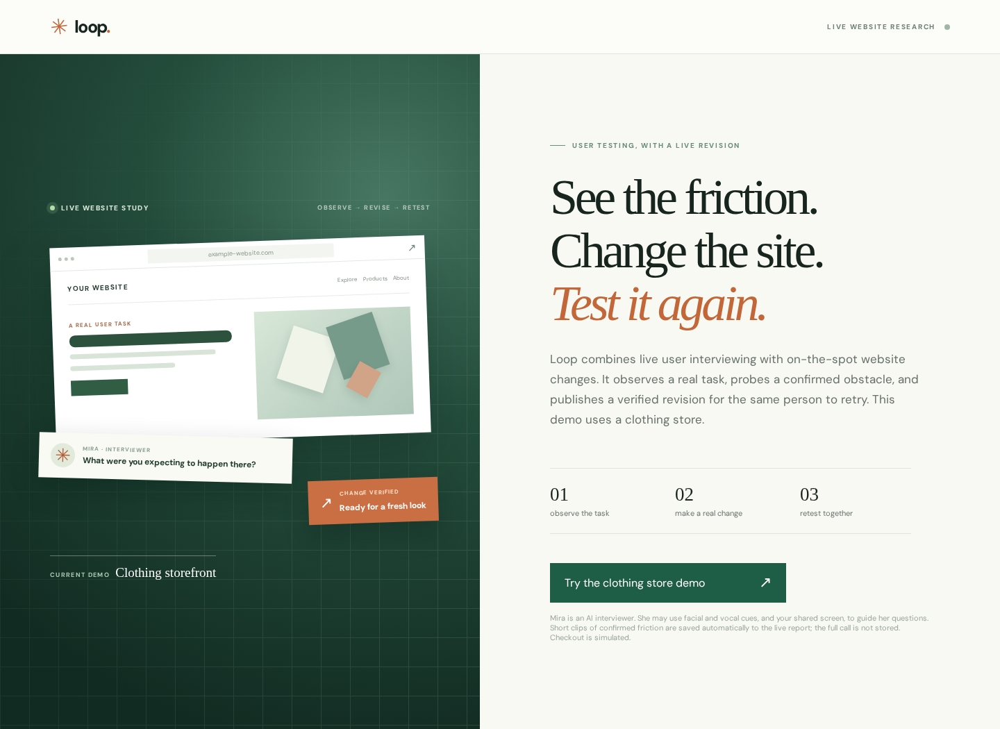

<div align="center">

# Loop

### See the friction. Change the site. Test it again.

**Live website research with a face-to-face AI interviewer and a coding agent.**

[Try the demo](https://35-226-89-51.sslip.io/) · [Architecture](docs/ARCHITECTURE.md) · [Run locally](docs/SETUP.md) · [Demo walkthrough](docs/DEMO.md)

[](https://github.com/PrakharGoel7/loop/actions/workflows/checks.yml)


</div>



## Overview

Loop is a dynamic user-testing platform that lets people test website changes during the same interview in which they request them.

A Tavus AI interviewer observes the participant's shared screen, listens to feedback, and asks questions about their experience. When the participant suggests an improvement, a coding worker builds the change in the background. The interviewer then invites them to try the updated website and share their reaction.

The demo uses a clothing store to show this workflow.

## Architecture


Tavus CVI conducts the interview, draws on prior research, and requests website changes. The coding worker implements those changes for the participant to test. The website developer receives a report of the findings and feedback.

The diagram groups prior-research retrieval and stored interview evidence under **Knowledge Base**. Tavus handles retrieval; Loop stores session evidence and assembles the reports.

## Try it

**Hosted:** [Open Loop](https://35-226-89-51.sslip.io/). No invite code is required. Use a desktop browser, allow camera and microphone access, and share the store tab or window when asked. Checkout is simulated; no real payment is needed.

**Local:** Node.js 22.12+, pnpm 10, Git, an authenticated Codex CLI, and a Tavus API key are required for the full experience. FFmpeg prepares friction clips.

```bash
git clone https://github.com/PrakharGoel7/loop.git
cd loop
pnpm install --frozen-lockfile
cp .env.example .env
# Set LOOP_CODEX_BIN to your Codex executable in .env.
pnpm dev:all
```

Open `http://127.0.0.1:5173` and configure Tavus. See [setup instructions](docs/SETUP.md) for environment variables and knowledge-base configuration.

## Built with

React · TypeScript · Vite · Express · Tavus CVI · Daily · Codex CLI · FFmpeg · Google Cloud Storage

The hosted app and coding worker run on Google Compute Engine.
