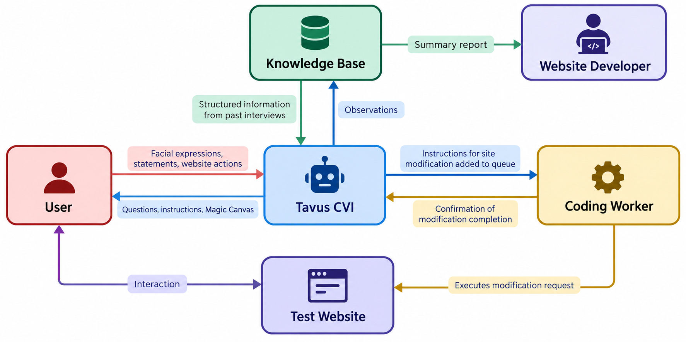

# Architecture

Loop brings user interviews, UI changes, and retesting into a single session.

- **User:** Interacts with the test website and the AI interviewer.
- **Tavus CVI:** Guides the conversation, observes the participant, retrieves prior-research context, and requests website modifications. Magic Canvas presents the website link.
- **Knowledge Base:** Provides context for interview questions. In the diagram, this also groups Loop's stored observations and reports; native Tavus retrieval and session storage are separate in the implementation.
- **Coding Worker:** Turns a requested improvement into a focused UI change, implements it, and returns the verified result.
- **Test Website:** The interface the participant explores and retests after changes are published.
- **Website Developer:** Reviews the report, including friction points, clips, quotes, fixes, feedback, and the timeline.

Loop's backend coordinates the queue and publication. Once the first journey is complete and the accepted changes are verified, it publishes the revised website for the participant to retry.
