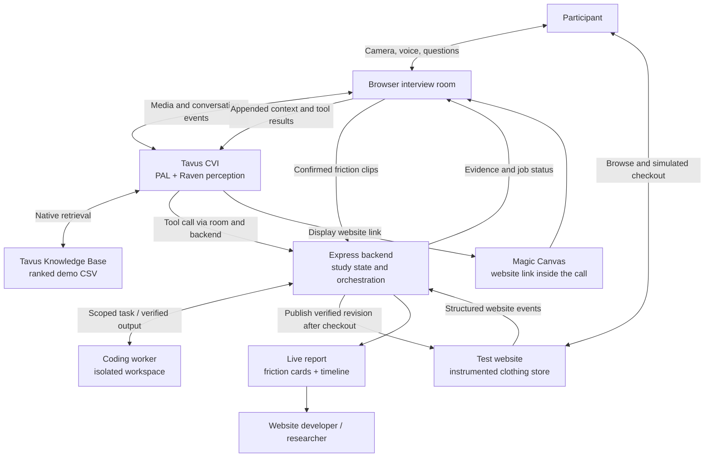

# Architecture

Loop separates the conversation, study state, and code execution. The sample store is instrumented so the interviewer has exact event context alongside Tavus's visual perception.



## Main pieces

| Piece | Responsibility | Source |
| --- | --- | --- |
| Interview room | Camera/mic, screen sharing, Magic Canvas, context delivery, clip capture, departure signal | `src/interview/`, `src/components/cvi/` |
| Tavus PAL | Natural conversation, multimodal perception, tool selection, objectives, knowledge retrieval | `server/tavus.ts`, `server/interviewer-prompt.ts`, `server/objectives.ts` |
| Backend | Owns study lifecycle, evidence, permissions, queue, and publish eligibility | `server/index.ts`, `server/state.ts`, `server/hosted-access.ts` |
| Planner and coder | Turn a suggestion into a scoped UI task; edit only permitted store source | `server/repair.ts`, `server/repair-context.ts`, `server/worker-tools.ts` |
| Worker transport | Runs the same work locally or on a warm remote machine over SSH | `server/remote-worker.ts` |
| Test website | Catalog, browsing, product selection, cart, simulated checkout, event instrumentation | `src/store/` |
| Report | Evidence-linked friction cards and event timeline | `server/report-summary.ts`, `src/report/` |

Mira is the interviewer's name, not a separate service. Magic Canvas is a Tavus surface embedded in the room. Website actions are structured events relayed as conversational context; shared-screen pixels independently reach CVI through screen sharing.

## A change from suggestion to publication

1. Mira asks about an observed action or cue. A cue alone is not a confirmed problem.
2. The participant explains the difficulty and suggests a resolution.
3. A repair tool call reserves one of two session-wide change slots. Duplicate requests and requests after the first journey are rejected.
4. The planner gets the evidence and bounded source context, then produces a focused change plan.
5. The coder edits an isolated workspace using bounded store tools. It has no general shell tool in this workflow.
6. The host validates scope, runs TypeScript and a production build, and optionally runs browser regression checks. One correction attempt is available for failed verification.
7. Job 2 starts planning only after job 1 has verified, so it sees the updated source.
8. Once all accepted jobs verify **and checkout/first-journey completion is recorded**, the backend publishes the combined revision. A failed job prevents collective publication.
9. The participant reloads when invited, evaluates each change, and gives feedback linked to the corresponding issue.

```text
plan 1 → code 1 → verify 1 → plan 2 → code 2 → verify 2
                                                      ↓
                          all verified + journey complete → publish
```

The interview runs alongside this queue. The debrief controls when Mira invites retry; it does not postpone an otherwise eligible publication.

## Local and hosted execution

**Local:** Vite serves the browser UI and proxies API calls to Express. Store baselines and generated revisions are kept locally. Publication and restoration check for unrelated edits before replacing store files.

**Hosted:** Express serves the app behind HTTPS. A separate warm worker performs planning, coding, and checks. Verified build artifacts are uploaded to private object storage; a per-study version pointer activates the completed revision. Publishing a shopper revision does not redeploy the whole app. Ending the study clears its active version.

The demo admits one active study. A warm worker avoids provisioning a new VM for each request, but model latency, code complexity, and verification retries still affect turnaround.

## Knowledge, clips, and reports

- `knowledge-base/past-user-issues.csv` is public synthetic demo data, imported through Tavus's Documents API. Conversations attach its document ID using Tavus's default retrieval strategy. The app checks processing status before starting.
- Short clips come from browser media composition and a rolling buffer. Only confirmed friction leads to saved clips. New studies do not request full-call Tavus recordings.
- Reports use stored evidence and exact quotes, not a second summarization model. Missing clips or feedback remain explicitly missing.
- Credentials, participant media, transcripts, and worker logs live outside Git. In hosted mode, signed visitor cookies enforce study ownership. Browser admin sign-in is disabled.

## Session cleanup

The room sends an end request on tab closure, browser Back, or route departure. Explicit call end uses the same backend cleanup. Duplicate end requests share an in-flight operation. Cleanup stops workers, restores the store, and completes recording/report bookkeeping.

Since browsers cannot guarantee delivery during crashes or network loss, the room also sends heartbeats. A server sweep expires studies after two minutes without a heartbeat, with up to 15 seconds of sweep delay. Switching tabs does not trigger departure. Reloading the interview page does trigger departure; reload the **store** for retesting.
